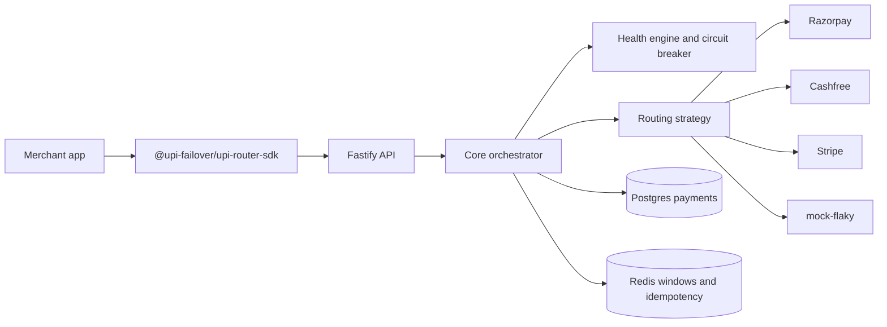

# UPI Failover Router

A payment orchestrator for Indian checkout. A merchant integrates once. Behind that integration the router watches gateway health and, when a charge has **definitively** failed, opens a new attempt on another gateway.

**Status: Phase 1.** The monorepo, CI, payment state contract, and health endpoints exist. Routing, failover, persistence, and live gateway calls are not implemented yet. `POST /v1/payments` is not mounted. Nothing in this tree moves money.

<!-- Demo GIF: docs/assets/demo.gif lands with the flash-sale simulation in Phase 7. -->

## Problem

During flash sales, a single UPI or netbanking provider can degrade and drop 15–20% of checkouts. This project is the seam where a second and third provider can take that traffic without a second integration, and without charging the customer twice.

## Architecture



Phase 1 ships the boxes and the contracts. Later phases fill them in. See [docs/architecture.md](docs/architecture.md).

## Quickstart

Node 20 and pnpm 10.

```bash
corepack enable
pnpm install
pnpm test
pnpm typecheck
```

Docker starts Postgres, Redis, and the API. The API currently serves health only.

```bash
docker compose up --build
curl -s localhost:3000/health
curl -s localhost:3000/v1/health/gateways
curl -s localhost:3000/metrics
```

Copy `.env.example` to `.env` for local overrides. Real gateway credentials stay empty. `USE_REAL_GATEWAYS` defaults to `false`.

## SDK

`@upi-failover/upi-router-sdk` exports `PaymentRouter`. Phase 1 validates config and the idempotency key, then refuses to send a request. The call shape that later phases will honour:

```ts
import { PaymentRouter } from '@upi-failover/upi-router-sdk';

const router = new PaymentRouter({
  apiKey: process.env.MERCHANT_API_KEY!,
  baseUrl: 'http://localhost:3000',
});

const payment = await router.payments.create({
  amount: 49900,
  currency: 'INR',
  method: 'upi',
  upiFlow: 'intent',
  orderId: 'order_123',
  customer: { id: 'cust_123' },
  idempotencyKey: 'idem_12345678',
});

// On failover the customer may have to approve a new UPI intent.
// payment.nextAction is { type: 'upi_intent', uri } or { type: 'collect_pending' }.
await router.payments.waitForFinalState(payment.id, { timeoutMs: 120_000 });
```

Build the publishable package with `pnpm --filter @upi-failover/upi-router-sdk build` (ESM, CJS, and `.d.ts` via tsup). Runtime dependencies: none. The HTTP client lands in Phase 6.

## Routing sketch

```
score = w_success * successRate + w_latency * (1 - normLatency) - w_cost * normMDR
```

Defaults live in `packages/core/src/routing.config.ts`. Success weight is 0.7, latency 0.25, cost 0.05. UPI MDR is configuration, not a constant, because P2M UPI is often zero and then cost drops out of the ranking. The scorer itself is Phase 4. Details: [docs/routing.md](docs/routing.md).

## Failover rules already encoded

- Same `Idempotency-Key` must return the same payment.
- `TIMEOUT_AMBIGUOUS` is not failover-eligible. Status is queried first. If it stays unknown, the payment is `UNKNOWN` and is not sent to a second gateway.
- Only `GATEWAY_DOWN` and `BANK_DOWN` may fail over.
- `USER_ABANDONED` and `DEFINITIVE_DECLINE` never change gateway.
- A parent in `UNKNOWN` cannot transition to `FAILOVER_ROUTED`.
- A late success on an attempt that already failed over becomes a `DoubleCaptureRisk` (`refund_required`), not a second capture.

State diagram and the extra edges: [docs/failover.md](docs/failover.md).

UPI failover creates a **new** intent or collect on the next gateway from stored order and customer data. The customer does not retype details. They may have to approve again in their UPI app.

## Benchmark

The flash-sale simulation (10,000 payments, one gateway degraded to 50% success, zero double-captures) is Phase 7. No success-rate numbers are claimed yet. Placeholder: [examples/flash-sale-sim/README.md](examples/flash-sale-sim/README.md).

## Limitations

- Sandbox and mocks only. No production gateway certification.
- Not PCI-DSS audited. Card numbers, CVV, and PAN are rejected at the schema boundary. Card charges, when they exist, will use a gateway-hosted token.
- VPAs are masked in logs. The raw VPA needed for UPI collect failover will be encrypted at rest (Phase 2); it is not stored on the `Payment` record.
- A failover UPI attempt needs a fresh customer approval.
- Phase 1 does not create charges, persist payments, or route traffic.

## Repository layout

```
packages/core        state machine, types, redaction, idempotency contract
packages/adapters    Razorpay, Cashfree, Stripe, mock-flaky contracts
packages/sdk         @upi-failover/upi-router-sdk
apps/server          Fastify health API
apps/dashboard       Phase 6 placeholder
docs                 architecture, routing, failover, OpenAPI stub
examples             checkout and flash-sale placeholders
```

## License

[MIT](LICENSE).
