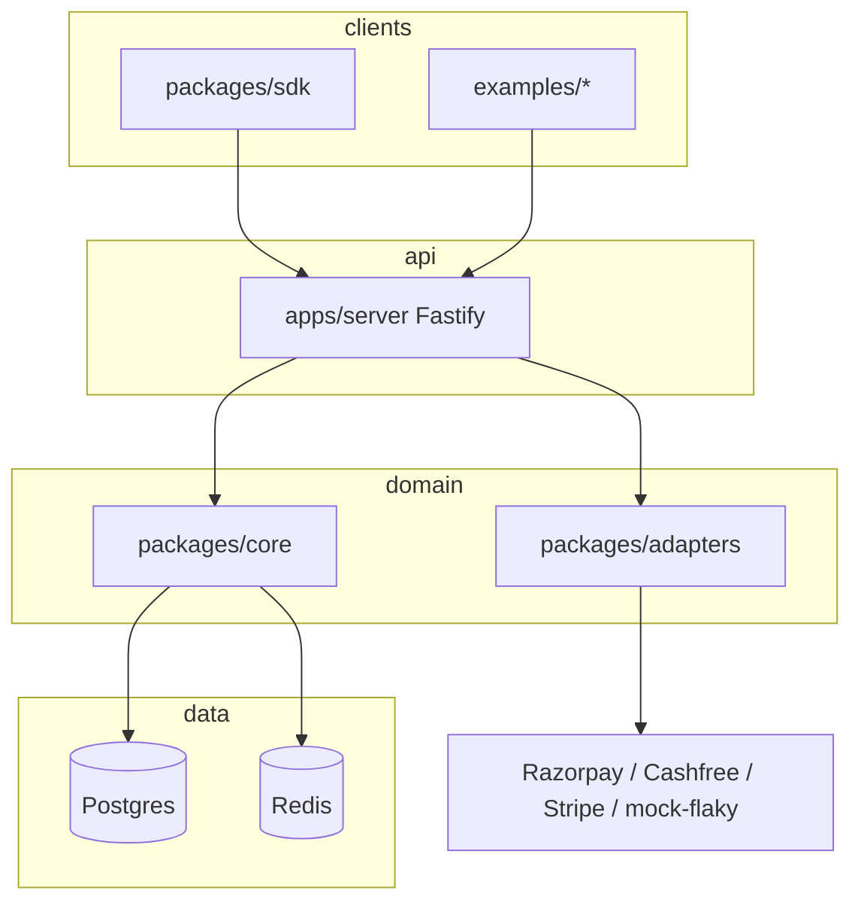

# Architecture

Phase 1 establishes the process boundaries and the types those processes will share. It does not route or charge.



| Package             | Phase 1                                                                                        | Later                                    |
| ------------------- | ---------------------------------------------------------------------------------------------- | ---------------------------------------- |
| `packages/core`     | State machine, failure policy, redaction, idempotency hash, routing defaults, store interfaces | Persistence, scoring, circuit breaker    |
| `packages/adapters` | Credential checks, chaos-profile parser, registry                                              | Sandbox calls and mock chaos             |
| `packages/sdk`      | Typed client that refuses to send                                                              | `fetch`, retries, webhook HMAC           |
| `apps/server`       | `/health`, `/v1/health/gateways`, `/metrics`                                                   | Payments, webhooks, auth, reconciliation |

Core has no network, database, or Redis client. Adapters depend on core. The server depends on both. The published SDK depends on neither, so it can be installed without the orchestrator source.

Postgres and Redis are in `docker-compose.yml` so the runtime shape is already the one Phase 2 and Phase 4 will use. The Phase 1 process does not connect to them.

## Request identity

Every response includes `x-request-id`. Errors use one shape:

```json
{ "error": { "code": "not_found", "message": "...", "requestId": "..." } }
```

`/v1/payments`, webhooks, and the admin override route are specified in `PROJECT_SPEC.md` and are intentionally not mounted until the orchestrator can uphold the double-charge rules.
