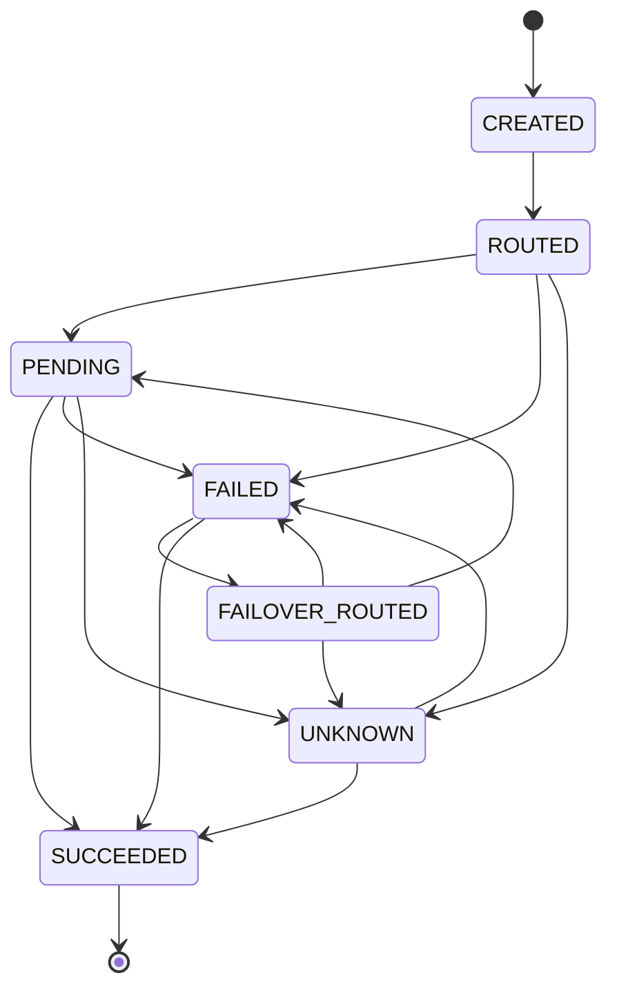

# Failover

## State machine

`packages/core/src/state-machine.ts` is the guard. Same-state updates are not transitions; duplicate webhooks are no-ops.

Edges beyond the one-line spec chain:

| Edge                                                       | Why                                                                           |
| ---------------------------------------------------------- | ----------------------------------------------------------------------------- |
| `ROUTED → FAILED` and `ROUTED → UNKNOWN`                   | The create call can fail before the customer has a pending intent.            |
| `FAILOVER_ROUTED → FAILED` and `FAILOVER_ROUTED → UNKNOWN` | The second create call can fail the same way.                                 |
| `FAILED → SUCCEEDED`                                       | A status check shows the only attempt actually captured, before any failover. |
| `UNKNOWN → SUCCEEDED` and `UNKNOWN → FAILED`               | Reconciliation resolved the attempt.                                          |

`UNKNOWN → FAILOVER_ROUTED` is forbidden. An unknown result is not a failed charge.

Attempts have their own map. An attempt never enters `FAILOVER_ROUTED`; the parent does, between attempt 1 and attempt 2.

## What may be retried

| Failure class        | Another gateway?                                                                                                         |
| -------------------- | ------------------------------------------------------------------------------------------------------------------------ |
| `GATEWAY_DOWN`       | Yes, under `maxAttempts` (default 2) and the time budget                                                                 |
| `BANK_DOWN`          | Yes, once the outage is confirmed                                                                                        |
| `DEFINITIVE_DECLINE` | No. Insufficient funds, wrong PIN, and other customer declines stick.                                                    |
| `USER_ABANDONED`     | No                                                                                                                       |
| `TIMEOUT_AMBIGUOUS`  | No. Query the original gateway with a bounded retry. Then `SUCCEEDED`, `FAILED`, or `UNKNOWN` plus a reconciliation job. |

## UPI

Failover does not replay the same gateway reference. It creates a new intent or collect on gateway B from the stored order and customer. The HTTP response carries `nextAction`:

- `{ "type": "upi_intent", "uri": "upi://pay?..." }`
- `{ "type": "collect_pending" }`

The shopper does not re-enter details. Their UPI app may ask them to approve the new request.

## Double capture

If attempt 1 is marked failed, attempt 2 captures, and a late webhook says attempt 1 also captured, the orchestrator records a `DoubleCaptureRisk` with `action: "refund_required"`. It must not create attempt 3. Phase 5 performs the refund and the alert. The type exists now so that path cannot be "just another success".
